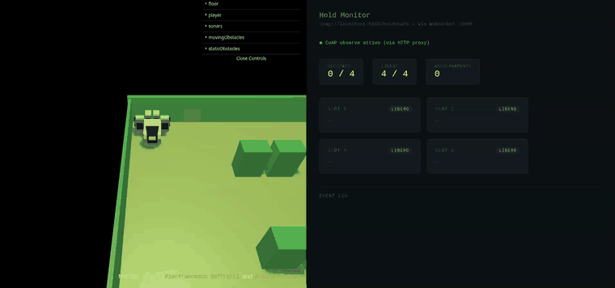
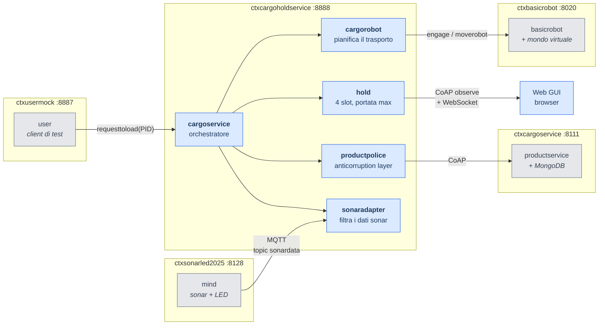
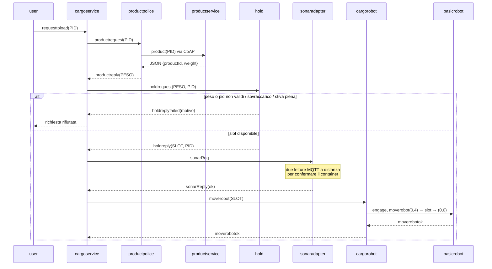
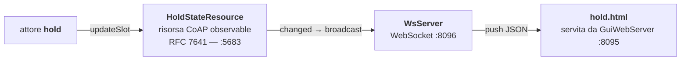

# cargoservice — automazione del carico merci in stiva

Sistema distribuito che automatizza il caricamento di container nella stiva di
una nave cargo per mezzo di un robot a guida differenziale, con stato della
stiva osservabile in tempo reale da una web GUI.

Progetto finale di **Ingegneria dei Sistemi Software** (prof. A. Natali,
Università di Bologna, a.a. 2024/2025), sviluppato in team da 3 persone lungo
4 sprint.

> Lo scopo del tema d'anno non era (solo) risolvere il problema, ma avere un
> **caso di studio su cui ragionare sul processo di costruzione del software**.
> Questo README è organizzato di conseguenza: prima cosa fa il sistema, poi
> perché è fatto così.

---

## Indice

- [Il problema](#il-problema)
- [Demo](#demo)
- [Architettura](#architettura)
- [Il flusso di una richiesta](#il-flusso-di-una-richiesta)
- [Osservabilità: dalla stiva al browser](#osservabilità-dalla-stiva-al-browser)
- [Perché un DSL ad attori](#perché-un-dsl-ad-attori)
- [Come eseguirlo](#come-eseguirlo)
- [Test](#test)
- [Il processo: gli sprint](#il-processo-gli-sprint)
- [Il team](#il-team)
- [Limiti noti e cosa farei diversamente](#limiti-noti-e-cosa-farei-diversamente)

---

## Il problema

Una compagnia di trasporto marittimo vuole automatizzare il carico di merci
nella stiva di una nave. I prodotti sono registrati in un servizio esterno
(`productservice`) che ne restituisce identificativo e peso.

La stiva è un'area rettangolare con una porta di ingresso (IOPort) e **4 slot**
per i container. Un sonar davanti alla IOPort rileva la presenza di un
container. Il sistema da costruire, `cargoservice`, deve:

1. accettare o rifiutare richieste di carico — rifiuto se il peso supera la
   portata massima della nave o se la stiva è piena;
2. assegnare uno slot al prodotto accettato e attendere il container alla IOPort,
   **senza elaborare altre richieste nel frattempo**;
3. rilevare col sonar la presenza del container alla IOPort;
4. far depositare il container nello slot riservato dal `cargorobot`, che poi
   torna alla posizione HOME;
5. mostrare lo stato corrente della stiva su una **web GUI aggiornata dinamicamente**;
6. interrompere l'attività e accendere un LED se il sonar misura una distanza
   anomala per almeno 3 secondi (possibile guasto).

Il testo integrale del committente è in
[userDocs/TemaFinale25.pdf](userDocs/TemaFinale25.pdf).

## Demo

<!-- TODO: inserire qui la GIF della web GUI che si aggiorna durante un carico.
     Registrare: avvio del sistema, userMock che invia 4 richieste, gli slot
     che si accendono in push, e un rifiuto per stiva piena. -->



## Architettura

Il sistema è distribuito su più **contesti** (nodi computazionali autonomi).
I componenti in grigio sono forniti dal committente; quelli in blu sono stati
sviluppati da noi.



Ogni riquadro è un **contesto qak**: un processo autonomo, deployabile come
container separato. La scoperta reciproca avviene tramite **Eureka**, per cui i
contesti si dichiarano `host="discoverable"` e non hanno indirizzi cablati.

Il modello eseguibile completo è in
[`sprint3/cargoservice_sprint3/src/cargoservice.qak`](sprint3/cargoservice_sprint3/src/cargoservice.qak).

## Il flusso di una richiesta

`cargoservice` è una macchina a stati finiti che elabora **una richiesta per
volta** — è il modo in cui il requisito 2 ("nel frattempo altre richieste non
sono elaborate") viene soddisfatto per costruzione, non con un lock.



In caso di fallimento a valle della prenotazione, `cargoservice` invia
`slotrelease(SLOT)` alla stiva: lo slot riservato non resta bloccato.

## Osservabilità: dalla stiva al browser

Il requisito della GUI dinamica è stato risolto **senza polling**. La catena:



Il ragionamento dietro questa scelta, in breve:

- il polling HTTP introduce latenza artificiale e carico inutile su un sistema
  già event-driven;
- **CoAP observe** notifica i client quando la risorsa cambia, ed è il
  meccanismo naturale in questo dominio — ma il browser non parla CoAP;
- serve quindi un **adapter**: `WsServer` traduce le notifiche in messaggi
  WebSocket, senza conoscere la semantica dello stato che trasporta.

L'attore `hold` è l'unico componente che tocca `HoldStateResource`. La GUI non
accede mai allo stato interno degli attori: la risorsa CoAP è il contratto
pubblico tra dominio e presentazione.

## Perché un DSL ad attori

Il sistema è modellato in **qak**, un linguaggio di modellazione eseguibile
sviluppato per il corso (DSL definito con Xtext, che genera Kotlin).

La motivazione non è "era il linguaggio del corso". I requisiti descrivono
componenti che *dialogano*: richieste con risposta, notifiche asincrone,
sottoscrizioni a eventi. In Java o Kotlin puri questi concetti non esistono
come costrutti: vanno ricostruiti a mano con thread, code e callback, e la
struttura conversazionale del problema si perde nel codice di supporto.

qak colma questo **abstraction gap** rendendo primitivi del linguaggio:

| Concetto | Costrutto qak |
|---|---|
| Componente attivo autonomo | `QActor` |
| Nodo di deployment | `Context` |
| Messaggio asincrono senza risposta | `Dispatch` |
| Richiesta con risposta attesa | `Request` / `Reply` |
| Notifica broadcast | `Event` (su MQTT) |
| Comportamento | macchina a stati finiti esplicita |

Il vantaggio pratico: la macchina a stati di `cargoservice` **è** il modello,
non un commento che descrive il codice. Il modello è eseguibile, quindi
verificabile con il committente prima di scrivere l'implementazione.

Il prezzo: tooling legato a Eclipse, codice generato poco leggibile in debug, e
un linguaggio che nessuno conosce fuori dal corso. Per un prototipo di sistema
distribuito da validare in fretta il compromesso conviene; per un prodotto da
mantenere per anni la valutazione sarebbe diversa.

Documentazione del linguaggio: [userDocs/](userDocs/).

## Come eseguirlo

**Prerequisiti:** JDK 17+ (Gradle scarica da solo la toolchain corretta),
Docker e Docker Compose.

### Solo i test della business logic

Non richiede Docker ne hardware:

```bash
cd sprint3/cargoservice_sprint3
./gradlew test
```

### Il sistema completo

```bash
docker network create iss-network
cd sprint3/uniboyamls
docker compose -f cargoserviceqak.yaml up
```

Poi apri la GUI su **http://localhost:8095/hold.html**.

Il file compose avvia 8 servizi: `cargoholdservice` (il nostro sistema),
`cargoserviceqak` (productservice), `basicrobot24` e `wenv` (robot e mondo
virtuale), `usermock` (client di test), `mosquitto` (MQTT), `mongodb` ed
`eureka` (service discovery).

> **Nota sugli indirizzi.** Le variabili `SERVICE_IP` nel file compose vanno
> impostate all'IP della macchina host: Eureka pubblica quell'indirizzo agli
> altri servizi, e l'IP interno del container non è raggiungibile dall'esterno.
> Si veda [docs/DEPLOYMENT.md](docs/DEPLOYMENT.md).

## Test

La business logic della stiva è verificata da una suite di unit test che
riproduce il **Test Plan** formalizzato nella chronicle dello Sprint 1:

```bash
cd sprint3/cargoservice_sprint3 && ./gradlew test
```

Gli scenari coperti — carico standard, rifiuto per sovrappeso, rifiuto per
stiva piena, payload invalido, ciclo prenotazione/rilascio, mappatura slot →
coordinate — sono in
[`CargoHoldTest.kt`](sprint3/cargoservice_sprint3/src/test/kotlin/it/unibo/hold/CargoHoldTest.kt).

Per renderli possibili la logica di dominio è stata estratta dall'attore in
[`CargoHold.kt`](sprint3/cargoservice_sprint3/src/main/kotlin/it/unibo/hold/CargoHold.kt),
una classe pura senza dipendenze dall'infrastruttura ad attori. L'attore `hold`
resta responsabile del protocollo; le regole di business sono verificabili in
isolamento.

**I test hanno trovato un bug reale.** Nel modello qak il rilascio di uno slot
eseguiva:

```kotlin
release(idx)              // azzera slotPeso[idx]
totPeso -= slotPeso[idx]  // ...e quindi sottrae zero
```

Il peso totale non calava mai al rilascio di uno slot. Ogni richiesta rifiutata
dopo aver prenotato uno slot lasciava il proprio peso nel conteggio, finché la
stiva rispondeva `OVERWEIGHT` anche da vuota. In `CargoHold` il carico corrente
è derivato dagli slot, quindi l'incoerenza non e più rappresentabile.

## Il processo: gli sprint

Ogni sprint affronta un sottoinsieme dei requisiti e produce una *chronicle*
con requisiti, analisi del problema, test plan e architettura risultante.

| Sprint | Goal | Chronicle |
|---|---|---|
| **0** | Formalizzare i termini del problema, distinguere cosa e fornito dal committente da cosa va sviluppato, architettura logica di riferimento | [chronicle](sprint0/chronicles_sprint0_v4.pdf) |
| **1** | Primo prototipo del flusso di carico: `cargoservice`, `productpolice`, `hold` | [chronicle](sprint1/cargoservice_sprint1/chronicles_sprint1_v3.pdf) |
| **2** | Integrazione del sonar reale via MQTT, nasce `sonaradapter`; refactoring della stiva | [chronicle](sprint2/chronicles_sprint2_v0.pdf) · [refactoring](sprint2/cargoHold_refactoring.pdf) |
| **3** | Web GUI reattiva, containerizzazione, service discovery con Eureka | [chronicle](sprint3/chronicle_sprint3_v0.pdf) |

La cartella [`sprint1_pojoHold/`](sprint1_pojoHold/) contiene una variante
esplorativa in cui la stiva era un POJO anziche un attore: utile per confrontare
i due approcci, non fa parte della linea principale.

**La versione finale è [`sprint3/cargoservice_sprint3/`](sprint3/cargoservice_sprint3/).**

## Il team

Progetto sviluppato da **Diego Bruno**, **Marco Crisafulli** e
**Sebastiano Giannitti**.

<!-- TODO: sostituire con la ripartizione reale dalla presentazione LaTeX.
     Il corso richiedeva esplicitamente di presentare "l'attività specifica di
     ciascun componente del team" (TemaFinaleNote). -->

Ripartizione delle attività: _da completare_.

Il repository originale del team, con la storia completa dei commit, è
[MarcoCrisafulli5/ISS2025-BrunoCrisafulliGiannitti](https://github.com/MarcoCrisafulli5/ISS2025-BrunoCrisafulliGiannitti).

## Limiti noti e cosa farei diversamente

Elenco onesto di ciò che, rifacendolo, cambierei.

**Sincronizzazione basata su ritardi.** In più punti il modello usa `delay`
fisso al posto di una vera attesa di evento — per esempio `delay 5000` dopo aver
interrogato la stiva. Funziona nella demo ma è fragile: sotto carico o con
latenza di rete il timing salta. La transizione `whenReply` c'è già, il `delay`
è ridondante e andrebbe rimosso.

**Il requisito dei 3 secondi è approssimato.** `sonaradapter` campiona due volte
a 2 secondi di distanza assumendo che il sonar emetta un dato al secondo. Un
sonar più lento o più veloce cambia la semantica. La versione corretta userebbe
i timestamp dei campioni e una finestra temporale esplicita, non il conteggio
delle letture.

**Il LED del requisito 6 non è pilotato dal nostro sistema.** La logica di
accensione vive nel progetto `sonarLed2025` fornito con il corso;
`sonaradapter` rileva il guasto e rifiuta la richiesta, ma non comanda il LED.

**Configurazione ancora parzialmente cablata.** Gli IP nel file compose vanno
adattati a mano alla macchina host.

**Le librerie del corso inquinano il classpath.** `2p301.jar` (tuProlog) è un
fat jar che include una copia arcaica di `org.junit.Assert`, priva di metà dei
metodi della JUnit moderna. Essendo una dipendenza `flatDir`, Gradle non ne
conosce le dipendenze transitive e non può deduplicarla: quella copia oscura la
JUnit 4.13.2 correttamente risolta. Non è un problema nostro, ma condiziona come
si scrivono i test.

**Copertura dei test limitata al dominio della stiva.** Le macchine a stati
degli attori sono verificate solo manualmente tramite `usermock`. Testare una
FSM qak richiede un contesto attivo: fattibile, ma non affrontato.
